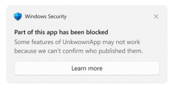

# Sixian's First Small Neural Network, Version 1

This is a small neural network I wrote from scratch in C++. For this demo, it learns two things:

- **XOR**: simple XOR simualtor, too see if it can pick up basic patterns and test if teh most basic components of training work (i.e. it doesnt implode immediatly when ran)
- **Handwritten digits (MNIST)**: training on the MNIST digits dataset. Can usually get to around 95% accuracy after only a few epochs. Better demonstration of actual NN learning.

## Why I made this

Neural Networks have always been intresting to me in the sense that they are able to learn and adapt to multiple tasks, not unlike a human, compared to more determinstic algorithims like fibonacci sequence.

I mostly learned the math and principles from youtube tutorials. 

## Credit

The MNIST data in `data/mnist/` was downloaded from https://github.com/cvdfoundation/mnist.

## Build

C++17 compiler needed.

### Windows (MSVC)

From a **Developer Command Prompt for Visual Studio** (so that `cl` is on the path) command window, under the repository root, run:

```
cl /O2 /EHsc /std:c++17 /Fenn.exe main.cpp neuralNetwork.cpp nodes.cpp functions.cpp mnist.cpp
```

### Linux (Verified on Ubuntu and g++)

```
g++ -O2 -std=c++17 -o nn main.cpp neuralNetwork.cpp nodes.cpp functions.cpp mnist.cpp
```

Keep optimization on (`/O2` or `-O2`); cuz without it, MNIST training is much slower.

## Run

From the repository root, run:

```
nn.exe
```

To use the MNIST files in a different folder, pass the folder as the first arg:

```
nn.exe path/to/mnist
```

## Troubleshooting: "Part of this app has been blocked" on Windows  
Sometimes when running demo on Windows, this issue occurs



This is a problem with Windows security feature. Smart App Control blocks it because nn.exe isn't digitally signed. According to the MS support page:  


Workaround: From what I can tell, just wait a few minutes then recompile and run. More permanent fix would be to sign nn.exe with a trusted code signing certificate, but haven't researched how to do that.  

